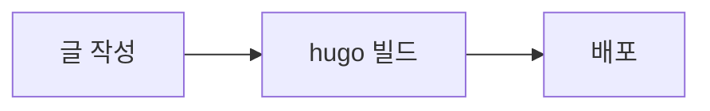

# 이것저것

[Hugo](https://gohugo.io/) 0.169.0 extended 로 만드는 개인 블로그입니다. 외부 테마 없이 `layouts/` 와 `assets/` 에 있는 자체 픽셀 테마를 씁니다. 참고하거나 불러오는 외부 프로젝트와 라이선스는 [THIRD_PARTY_NOTICES.md](THIRD_PARTY_NOTICES.md) 에 정리했습니다.

## 로컬에서 실행하기

```bash
hugo server
```

`http://localhost:1313/` 에서 미리 볼 수 있습니다. 초안까지 보려면 `hugo server -D` 를 실행합니다.

## 빌드하기와 게이트

배포 workflow 와 같은 플래그로 빌드합니다. 폐기 예정 설정이나 함수를 쓰면 경고 때문에 빌드가 실패합니다.

```bash
hugo --gc --minify --panicOnWarning
```

결과물은 `public/` 에 생성되며, 이 디렉터리는 git 이 추적하지 않습니다.

변경 사항을 올리기 전에는 아래 게이트 명령으로 빈 디렉터리에 빌드해서, 종료 코드가 0 이고 출력에 `WARN` 이 없는지 확인합니다.

```bash
rm -rf /tmp/harness-blog-site && hugo --gc --minify --panicOnWarning -d /tmp/harness-blog-site
```

## 글 쓰기

글 주소는 `/posts/<slug>/` 입니다. 글은 두 가지 방식으로 둘 수 있습니다.

- 단일 파일: `content/posts/my-post.md` 처럼 Markdown 파일 하나로 둡니다. 대표 이미지는 쓸 수 없고, 카드에는 자동 무늬가 나옵니다.
- 페이지 번들: `content/posts/my-post/index.md` 처럼 글마다 디렉터리를 만들고, 같은 디렉터리에 이미지를 함께 둡니다.

```toml
+++
title = '글 제목'
date = 2026-11-11T20:00:00+09:00
slug = 'my-first-post'
tags = ['hugo', '블로그']
categories = ['기록']
summary = '카드와 검색 결과에 보여 줄 한두 문장입니다.'
+++

본문을 여기에 씁니다.
```

`summary` 를 생략하면 본문 앞부분을 요약으로 씁니다.

### 대표 이미지(featured.* 와 featured_alt)

페이지 번들 안에 `featured.png`, `featured.jpg`, `featured.jpeg`, `featured.webp` 가운데 하나를 두면 대표 이미지로 씁니다. Hugo 이미지 처리로 크기를 줄인 WebP 를 만들어 카드 썸네일과 글 위쪽에 보여 줍니다. 사진 자체는 픽셀 처리하지 않고, 테두리만 계단형 픽셀 모양입니다.

```text
content/posts/my-post/
├── index.md
└── featured.jpg
```

이미지 대체 텍스트는 `featured_alt` 로 적습니다. 적지 않으면 글 제목을 대체 텍스트로 씁니다.

```toml
featured_alt = '노을 진 언덕 위로 해가 지는 풍경'
```

### 자동 무늬

대표 이미지가 없는 글은 제목(제목이 없으면 slug)으로 정해지는 좌우 대칭 픽셀 무늬를 썸네일로 씁니다. 무늬는 빌드할 때 인라인 SVG 로 만들어지므로 제목이 같으면 언제나 같은 무늬가 나옵니다. 색은 Tokyo Night 강조색 가운데 2~3개를 쓰며, 라이트와 다크 모드에 맞게 바뀝니다. 따로 설정할 것은 없습니다.

### 시리즈(series 와 series_order)

같은 주제로 이어지는 글은 `series` 에 같은 이름을 적고, 시리즈 안의 순서를 `series_order` 로 적습니다.

```toml
series = ['픽셀 블로그 만들기']
series_order = 2
```

시리즈 글에는 본문 위에 시리즈 상자가 나오고, `/series/<시리즈 이름>/` 에서 시리즈 글을 카드로 모아 볼 수 있습니다. 두 곳 모두 같은 순서를 씁니다.

- `series_order` 가 있는 글을 그 값의 오름차순으로 먼저 보여 줍니다.
- `series_order` 가 없는 글은 날짜 오름차순으로 그 뒤에 보여 줍니다.

본문 아래의 관련 글은 태그와 카테고리가 겹치는 글을 최대 세 편까지 보여 줍니다. 같은 시리즈 글은 시리즈 상자에 이미 나오므로 관련 글에서 뺍니다.

### 알림

GitHub 와 같은 알림 문법을 씁니다. 종류는 `NOTE`(참고), `TIP`(팁), `IMPORTANT`(중요), `WARNING`(경고), `CAUTION`(주의) 다섯 가지입니다.

```markdown
> [!NOTE]
> 읽는 사람이 알아 두면 좋은 내용을 적습니다.

> [!WARNING] 직접 정한 제목
> 대괄호 뒤에 글을 적으면 기본 제목 대신 그 글을 제목으로 씁니다.
```

`[!...]` 가 없는 인용은 일반 인용문으로 보여 줍니다.

### Mermaid 다이어그램

코드 블록의 언어를 `mermaid` 로 적으면 다이어그램으로 그립니다.

````markdown

````

Mermaid 스크립트는 mermaid 코드 블록이 있는 글에서만 불러옵니다. 다이어그램 색은 사이트 색 토큰을 따르고, 테마를 바꾸면 다이어그램을 다시 그립니다. Mermaid 버전은 `assets/js/mermaid.js` 맨 위의 import 주소에서 바꿉니다.

## 검색

헤더의 검색 버튼이나 `⌘K`(Windows 와 Linux 에서는 `Ctrl+K`)로 검색 팝업을 엽니다.

- 빌드할 때 모든 글의 제목, 주소, 날짜, 태그, 카테고리, 시리즈, 요약, 본문 앞부분을 모아 `search-index.<hash>.json` 색인을 만듭니다.
- 팝업을 처음 열 때만 색인과 [Fuse.js](https://www.fusejs.io/) 를 불러옵니다. 그 전에는 검색 때문에 내려받는 파일이 없습니다.
- 제목, 태그, 카테고리, 본문 순서로 가중치를 두고 최대 8개 결과를 보여 줍니다.
- `↑` `↓` 로 결과를 고르고 `Enter` 로 그 글을 엽니다. `Esc` 나 팝업 바깥을 누르면 닫힙니다.

Fuse.js 버전은 `assets/js/search.js` 의 `FUSE_URL` 에서 바꿉니다. Fuse.js 나 Mermaid 버전을 바꾸면 THIRD_PARTY_NOTICES.md 의 버전도 함께 고칩니다.

## 홈 첫 화면 설정(params.hero 와 params.avatar)

홈 첫 페이지 위쪽에는 픽셀 배경 위에 프로필 사진, 닉네임, 한 줄 문구, GitHub 링크, '글 보기' 버튼을 보여 줍니다. 내용은 `hugo.toml` 의 `[params]` 에서 바꿉니다.

```toml
[params]
  github = 'https://github.com/huro0906'
  # 홈 첫 화면에 보여 줄 프로필 사진 주소입니다.
  avatar = 'https://github.com/huro0906.png'

  [params.hero]
    title = 'huro0906'
    intro = 'huro0906의 개발 블로그'
```

| 설정 | 설명 |
| --- | --- |
| `params.avatar` | 프로필 사진 주소입니다. 비우면 사진을 보여 주지 않습니다. |
| `params.hero.title` | 닉네임입니다. 비우면 사이트 제목(`title`)을 씁니다. |
| `params.hero.intro` | 닉네임 아래의 한 줄 문구입니다. 비우면 보여 주지 않습니다. |
| `params.github` | GitHub 아이콘 링크의 주소입니다. 비우면 링크를 보여 주지 않습니다. |

빌드할 때 환경 변수로 값을 덮어쓸 수도 있습니다. 예를 들어 `HUGO_PARAMS_HERO_TITLE=새닉네임 hugo` 로 빌드하면 닉네임만 바뀝니다.

## 배포

`main` 브랜치에 push 하면 GitHub Actions(`.github/workflows/pages-deploy.yml`)가 사이트를 빌드해서 GitHub Pages 에 배포합니다.
